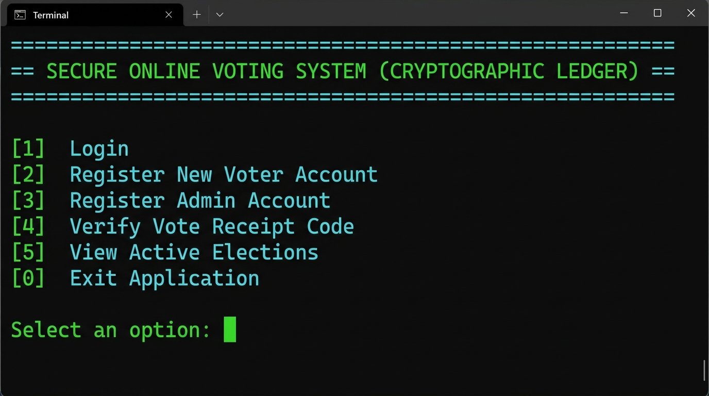
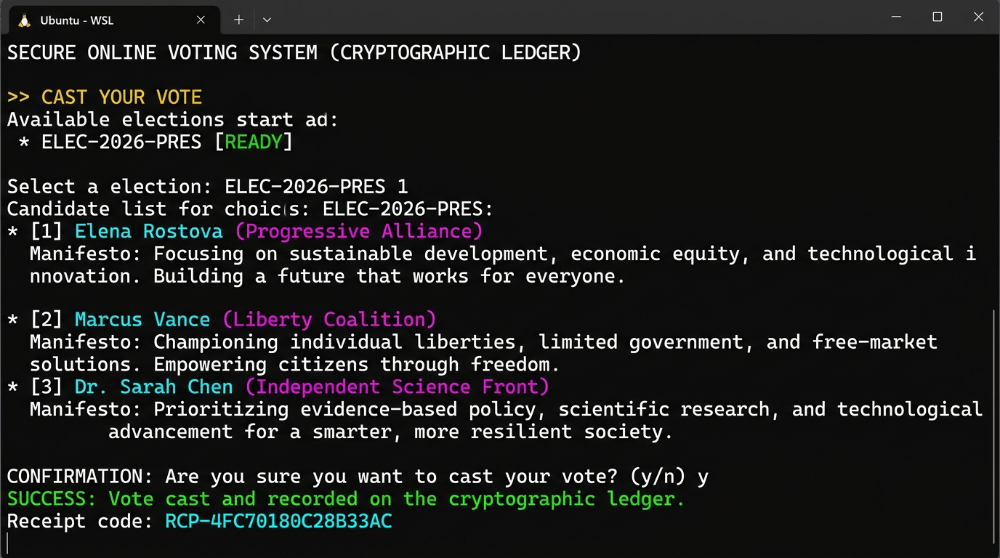
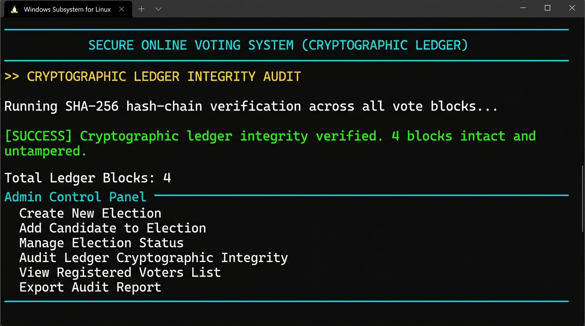
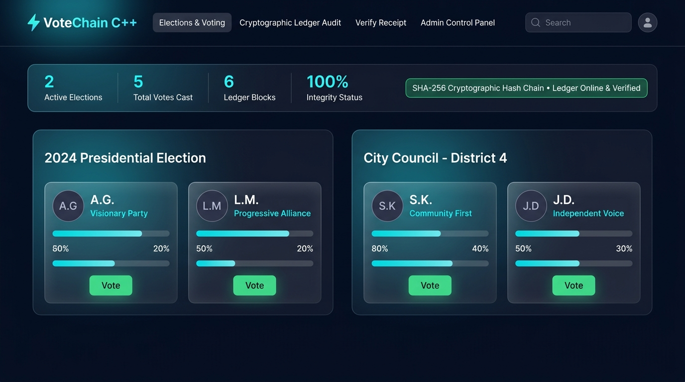

# ⚡ VoteChain — Secure Online Voting System in C++

<div align="center">


**A production-grade, tamper-evident Online Voting System built entirely in C++ with:**  
**SHA-256 cryptographic hashing · Blockchain-style immutable ledger · Role-based access control · Web application interface**

</div>

---

## 📸 Project Screenshots

### Main Menu (Terminal CLI Application)


### Voter Registration


### Voting — Cast Your Ballot & Receive Receipt Code


### Election Results with Winner Declaration


### Admin Panel — Cryptographic Ledger Integrity Audit


### Web Application Interface (VoteChain Website)


---

## 🌟 Features

| Feature | Description |
|---|---|
| 🔐 **SHA-256 Engine** | Pure C++ implementation — zero external dependencies |
| 🔗 **Blockchain Ledger** | Hash-chained vote blocks, sequential & tamper-evident |
| 🧾 **Voter Receipt Code** | Anonymous `RCP-XXXXXXXXXXXXXXXX` code for each vote |
| 🚫 **Double-Vote Prevention** | System enforces exactly one vote per voter per election |
| 👑 **Role-Based Access** | Separate Admin and Voter portals with authentication |
| 💾 **Data Persistence** | State saved across sessions via structured text data files |
| 🌐 **C++ Web Server** | Native TCP socket web server serving REST API + web UI |
| 🧪 **8 Automated Tests** | Full test suite covering all core system behaviors |

---

## 🏗️ Project Architecture

```
online_voting_system/
│
├── 📁 include/                 ← Header files (.hpp)
│   ├── CryptoUtils.hpp         ← SHA-256 engine, salt, receipt generator
│   ├── User.hpp                ← Base user entity
│   ├── Voter.hpp               ← Voter: tracks voted elections
│   ├── Admin.hpp               ← Admin entity & authorization
│   ├── Candidate.hpp           ← Candidate profile & manifesto
│   ├── Election.hpp            ← Election with status transitions
│   ├── Vote.hpp                ← Vote token entity
│   ├── Ledger.hpp              ← Immutable SHA-256 hash-chain ledger
│   ├── DataManager.hpp         ← State coordinator & file persistence
│   ├── ConsoleUI.hpp           ← Terminal interface
│   └── HttpServer.hpp          ← C++ Native TCP Web Server
│
├── 📁 src/                     ← Implementation files (.cpp)
│   ├── CryptoUtils.cpp
│   ├── User.cpp / Voter.cpp / Admin.cpp
│   ├── Candidate.cpp / Election.cpp / Vote.cpp
│   ├── Ledger.cpp
│   ├── DataManager.cpp
│   ├── ConsoleUI.cpp
│   ├── HttpServer.cpp          ← REST API + static file server
│   ├── main.cpp                ← CLI entry point
│   ├── main_web.cpp            ← Web server entry point
│   └── test_system.cpp         ← Automated test suite
│
├── 📁 data/                    ← Persistent data files
│   ├── voters.dat
│   ├── admins.dat
│   ├── elections.dat
│   ├── candidates.dat
│   └── ledger.dat
│
├── 📁 screenshots/             ← Project demo screenshots
├── CMakeLists.txt              ← CMake build configuration
├── Makefile                    ← GNU Make build file
├── build.sh                    ← Linux/WSL build script
└── build.bat                   ← Windows build script
```

---

## 🔐 How the Cryptographic Ledger Works

Every vote cast is converted into a cryptographic block and appended to an immutable chain:

```
┌─────────────────────┐       ┌─────────────────────┐       ┌─────────────────────┐
│   BLOCK #0 (Genesis)│──────▶│      BLOCK #1        │──────▶│      BLOCK #2        │
│─────────────────────│       │─────────────────────│       │─────────────────────│
│ Index: 0            │       │ Index: 1            │       │ Index: 2            │
│ PrevHash: 0000...   │       │ PrevHash: a4f2...   │       │ PrevHash: 7c91...   │
│ BlockHash: a4f2...  │       │ BlockHash: 7c91...  │       │ BlockHash: b38d...  │
│ Receipt: GENESIS    │       │ Receipt: RCP-4FC7.. │       │ Receipt: RCP-D64A.. │
└─────────────────────┘       └─────────────────────┘       └─────────────────────┘
```

- **Block Hash** = `SHA256(index + timestamp + vote_payload + previousHash)`
- Any modification to a block changes its hash → breaks all subsequent links
- Admin can run a live audit to detect tampering instantly

---

## 🚀 How to Build & Run

### Prerequisites
- `g++` with C++17 support (Linux, WSL, MinGW)

### Option 1: Terminal CLI Application

```bash
# On Linux / WSL
cd online_voting_system
./build.sh
./voting_system
```

```bat
# On Windows (Command Prompt)
build.bat
voting_system.exe
```

### Option 2: C++ Web Application Server

```bash
# Start the native C++ web server on http://localhost:8080
wsl --cd C:\path\to\online_voting_system ./cpp_voting_website_server
```

Then open your browser at **[http://localhost:8080](http://localhost:8080)**

---

## 🔑 Default Demo Accounts

| Role | Username | Password | Notes |
|------|----------|----------|-------|
| **Admin** | `admin` | `admin123` | Full control: create elections, audit ledger, manage users |
| **Voter 1** | `voter1` | `voter123` | Pre-approved voter (Alice Smith) |
| **Voter 2** | `voter2` | `voter123` | Pre-approved voter (Bob Jones) |

> 🔑 **Admin Registration Code** for adding new admin accounts: `ADMIN2026`

---

## 📋 Voter Flow — Step by Step

1. **Register** → Enter username, password, full name, and last 4 digits of National ID.
2. **Login** → Authenticate with username + password (SHA-256 salted hash verified).
3. **Browse Elections** → View active elections and all candidate manifestos.
4. **Cast Vote** → Select a candidate and confirm. System enforces no duplicate voting.
5. **Get Receipt Code** → Receive a unique anonymous code e.g. `RCP-4FC70180C28B33AC`.
6. **Verify Vote** → Enter receipt code anytime to verify your vote is in the ledger.

---

## 🛡️ Admin Flow — Step by Step

1. **Login** as `admin` with password `admin123`.
2. **Create Election** → Add title, description, start/end date.
3. **Add Candidates** → Register candidates with party name and manifesto.
4. **Open / Close Voting** → Toggle election status between UPCOMING, ACTIVE, CLOSED.
5. **Run Ledger Audit** → Verify SHA-256 hash chain integrity of all vote blocks.
6. **Export Report** → Generate full election results + audit log as text file.

---

## 🧪 Automated Test Suite Results

Run the full test suite:
```bash
wsl --cd C:\path\to\online_voting_system ./test_runner
```

```
========================================================
         RUNNING ONLINE VOTING SYSTEM TEST SUITE        
========================================================
[TEST 1] Verifying Initial Seed Data Loading...       ✅ PASSED
[TEST 2] Voter Registration & Authentication...       ✅ PASSED
[TEST 3] Admin Registration & Authorization...        ✅ PASSED
[TEST 4] Election Creation & Candidate Addition...    ✅ PASSED
[TEST 5] Vote Casting & Receipt Code Generation...    ✅ PASSED
[TEST 6] Double-Voting Prevention (Security)...       ✅ PASSED
[TEST 7] Cryptographic Hash-Chain Ledger Audit...     ✅ PASSED
[TEST 8] Receipt Code Lookup in Ledger...             ✅ PASSED
========================================================
        ALL 8 UNIT & SYSTEM TESTS PASSED CLEANLY!       
========================================================
```

---

## 🛠️ Technologies Used

- **Language**: C++17 (Standard Library only — no external libraries)
- **Cryptography**: Custom SHA-256 engine implemented in pure C++
- **Web Server**: Native POSIX/Winsock2 TCP socket server (multi-threaded)
- **Frontend**: HTML5 + Vanilla CSS + JavaScript (Glassmorphism design)
- **Build Tools**: GNU Make, CMake, g++ (GCC 13 via WSL/Ubuntu)
- **Data Storage**: Custom structured text file format (`.dat`)

---

## 📚 Concepts Demonstrated

- Object-Oriented Programming (Inheritance, Polymorphism)
- Cryptographic Hash Functions (SHA-256 from scratch)
- Blockchain / Distributed Ledger Technology concepts
- Role-Based Access Control (RBAC)
- Client-Server architecture (HTTP server from raw sockets)
- File I/O and state persistence
- Multi-threading (C++ `std::thread` for concurrent request handling)
- Secure password storage (Salt + Hash)

---

## 👨‍💻 Author

**Himanshu**  
C++ Online Voting System — Academic Project  
Built with ❤️ using Modern C++17

---

<div align="center">
<sub>⚡ VoteChain — Tamper-Evident, Cryptographically Secured, Decentralized Voting</sub>
</div>
